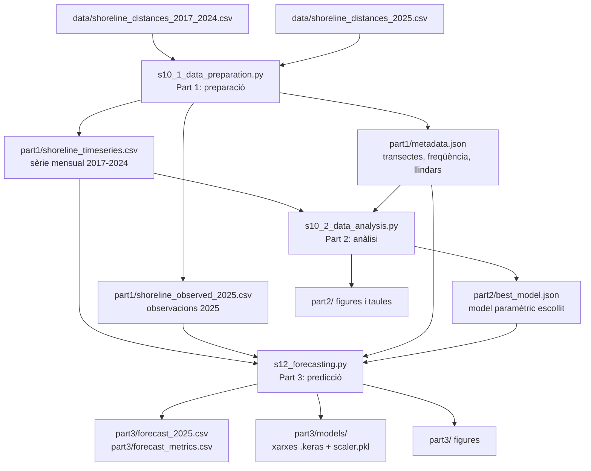
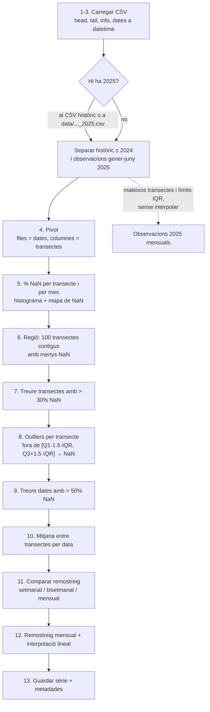
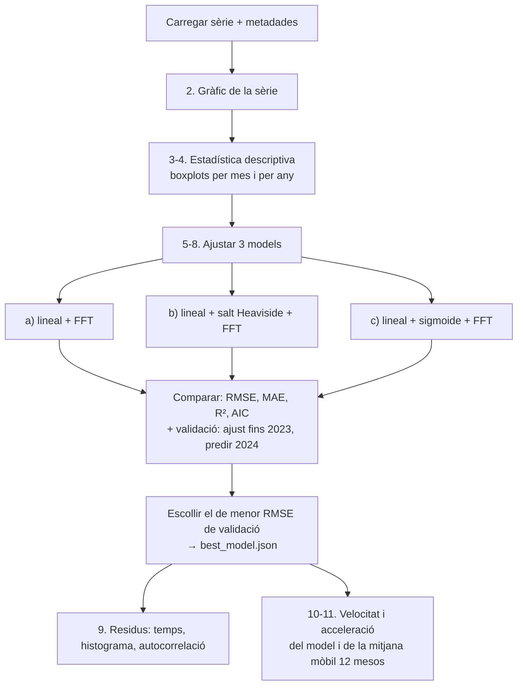
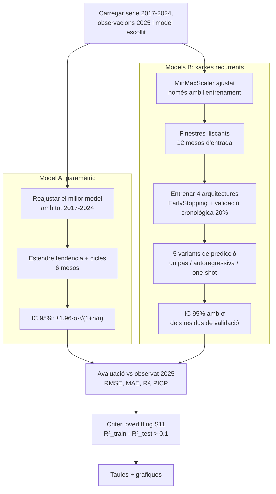

# ShoreTrend

Anàlisi i predicció de l'erosió de la costa de Castelldefels (CDIO1, sessions 10, 11 i 12).

A partir de les distàncies de la línia de costa mesurades per transecte (2017–2024), ShoreTrend:

1. construeix una sèrie temporal neta i regular (**Part 1**, S10);
2. n'analitza la tendència, l'estacionalitat, l'impacte del temporal Gloria i la velocitat/acceleració de l'erosió (**Part 2**, S10);
3. prediu gener–juny 2025 amb un model paramètric i amb xarxes recurrents (LSTM/GRU), i ho valida amb les observacions reals de 2025 (**Part 3**, S11 + S12).

---

## 1. Com executar-ho

### 1.1 Requisits

- La venv del repositori (Python 3.14), amb les llibreries de `requirements.txt`.
- **PyTorch**, que no és a `requirements.txt`. Keras 3 necessita un backend, i TensorFlow no està disponible per a Python 3.14. Si el teu entorn no el té:

```
Scripts\python.exe -m pip install torch --index-url https://download.pytorch.org/whl/cpu
```

El codi activa el backend tot sol (`KERAS_BACKEND=torch`); no cal configurar res més.

### 1.2 Dades d'entrada

Copia els CSV a `Homework/shoretrend/data/` amb **aquests noms exactes**:

| Fitxer | Contingut | Obligatori |
|---|---|---|
| `shoreline_distances_2017_2024.csv` | Històric 2017–2024 | Sí |
| `shoreline_distances_2025.csv` | Observacions gener–juny 2025 (a Atenea es diu `shoreline_distances_h1_2025.csv`) | Per validar la Part 3 |

Format: columnes `date, transect_id, distance_m`. Les altres columnes (`reference_x`, `reference_y`...) s'ignoren. Si no hi ha el fitxer de 2025, la Part 1 busca dates de 2025 dins de l'històric; si tampoc n'hi ha, la Part 3 fa la predicció però no la pot validar.

> Les observacions de 2025 han d'estar mesurades sobre els **mateixos transectes i la mateixa línia de referència** que l'històric. Per això no serveix el `shoreline_distances.csv` del nostre pipeline (`coastline_estimator/projects/castelldefels_h1_2025`): pren com a referència la primera data de 2025.

### 1.3 Execució

Des de l'arrel del repositori, **en aquest ordre** (cada part llegeix el que ha guardat l'anterior):

```
Scripts\python.exe Homework\shoretrend\s10_1_data_preparation.py
Scripts\python.exe Homework\shoretrend\s10_2_data_analysis.py
Scripts\python.exe Homework\shoretrend\s12_forecasting.py
```

Temps aproximats (CPU): Part 1 ~10 s, Part 2 ~5 s, Part 3 ~8 min la primera vegada (entrena 4 xarxes) i ~30 s les següents (carrega els models guardats).

Les figures es guarden a `output/` i no s'obren finestres; tot el que diu la consola es pot copiar al report.

### 1.4 Opcions

| Script | Opció | Efecte |
|---|---|---|
| `s10_1` | `-i <csv>` | Altre CSV històric |
| `s10_1` | `-o <csv>` | Altre CSV d'observacions 2025 |
| `s10_1` | `--start-transect N` | Fixa la regió de 100 transectes a partir de `N` (per defecte, la de menys NaN) |
| `s10_1` | `--freq W\|2W\|MS` | Freqüència de remostreig (per defecte `MS`, mensual) |
| `s10_2` | `--model linear\|step\|sigmoid` | Força el model paramètric que farà servir la Part 3 |
| `s10_2` | `--n-freq N` | Nombre de cicles FFT (per defecte 2) |
| `s12` | `--retrain` | Torna a entrenar les xarxes (si no, reutilitza les de `output/part3/models/`) |

> **Important:** si canvies les dades o les opcions de les Parts 1–2, executa la Part 3 amb `--retrain`. Si no, reutilitzarà xarxes entrenades amb la sèrie anterior.

---

## 2. Fitxers

```
Homework/shoretrend/
├── common.py                  # configuració, rutes, mètriques i model paramètric (compartit)
├── s10_1_data_preparation.py  # Part 1: CSV en brut -> sèrie mensual neta
├── s10_2_data_analysis.py     # Part 2: estadística, 3 models, residus, velocitat/acceleració
├── s12_forecasting.py         # Part 3: predicció 2025 (paramètric + LSTM/GRU) i avaluació
├── README.md
├── data/                      # CSV d'entrada (no es generen)
└── output/                    # tot el que generen els scripts
    ├── part1/
    ├── part2/
    └── part3/
        └── models/            # xarxes .keras i scaler.pkl guardats
```

| Fitxer | Què fa |
|---|---|
| `common.py` | Rutes de dades i sortides, dates clau (fi de l'històric, Gloria, finestra de predicció), funció `metrics` (RMSE, MAE, R²) i la classe `ParametricModel`, que fan servir la Part 2 i la Part 3. |
| `s10_1_data_preparation.py` | Passos 1–13 de la Part 1 del PDF: càrrega, pivot, anàlisi de NaN, selecció de transectes, outliers, filtre de dates, mitjana, remostreig, interpolació i guardat. També prepara les observacions de 2025 amb els mateixos criteris. |
| `s10_2_data_analysis.py` | Passos 1–11 de la Part 2: estadística descriptiva, boxplots, els tres models (lineal / salt / sigmoide + FFT), selecció del millor, residus, velocitat i acceleració. |
| `s12_forecasting.py` | Part 3 i tot el que demana la S11: predicció paramètrica amb IC 95%, cinc variants de xarxa recurrent amb les tres estratègies de predicció, mètriques train/validació/test, criteri d'overfitting i gràfiques comparatives. |

---

## 3. Flux general



Les tres parts es comuniquen només a través dels fitxers d'`output/`. Per això es poden tornar a executar per separat; per exemple, la Part 3 sola si només canvies les xarxes.

---

## 4. Part 1: preparació de dades (`s10_1_data_preparation.py`)

### Flux



### Lògica i decisions

- **Regió amb una finestra mòbil:** es calcula el % de NaN de cada transecte i s'agafa el bloc de 100 transectes **contigus** amb la mitjana més baixa. Han de ser contigus perquè volem una zona física concreta de platja, no transectes escampats.
- **Filtres per columnes i per files:** primer es treuen els transectes dolents i després les dates amb poca cobertura (> 50% de NaN), perquè la mitjana d'una data amb pocs transectes no és representativa de la regió.
- **Outliers per transecte, no globals:** cada transecte té la seva posició mitjana (la platja no és recta). Un valor normal en un transecte podria semblar un outlier en un altre.
- **Remostreig:** es comparen tres freqüències pel % d'intervals buits, la desviació i l'autocorrelació. El mensual és el per defecte: no deixa intervals buits i és el que fan servir les diapositives (`dt = 1` mes per a la velocitat).
- **Interpolació:** lineal en el temps. El script informa del buit consecutiu més llarg, per si la interpolació amagués un hivern sencer sense dades.
- **Observacions 2025:** passen pels **mateixos** transectes i límits IQR calculats amb l'històric, perquè la comparació sigui justa. **No s'interpolen**: un mes sense dades queda buit i no es fa servir per avaluar.

### Sortides (`output/part1/`)

| Fitxer | Contingut |
|---|---|
| `01_raw_data.png` | Dades en brut i mitjana per data |
| `02_missing_data.png` | % NaN per transecte, histograma i mapa de NaN |
| `03_resampling.png`, `resampling_comparison.csv` | Comparació de freqüències |
| `04_final_timeseries.png` | Sèrie final, amb els punts interpolats marcats |
| `shoreline_timeseries.csv` | Sèrie mensual (`date, distance_m, interpolated`) |
| `shoreline_observed_2025.csv` | Observacions mensuals de 2025 |
| `metadata.json` | Freqüència, regió, transectes vàlids, llindars i comptadors |

---

## 5. Part 2: anàlisi (`s10_2_data_analysis.py`)

### Flux



### Lògica del model paramètric (`common.ParametricModel`)

El model és **tendència + cicles**:

```
y(t) = tendència(t) + Σ Aₖ · cos(2π fₖ t + φₖ)
```

1. **Tendència**, per regressió. Hi ha tres variants:
   - `linear`: `a + b·t`
   - `step`: `a + b·t + c·H(t − t_Gloria)`, on `H` és el salt de Heaviside al febrer de 2020 (com a la diapositiva 12 de la S10).
   - `sigmoid`: `a + b·t + c / (1 + e^(−k(t − t₀)))`. `k` (velocitat de la transició) i `t₀` (moment del canvi, ±12 mesos al voltant de Gloria) s'ajusten amb `scipy.optimize.curve_fit` (diapositiva 13).
2. **Cicles**: a la sèrie sense tendència se li aplica la FFT (`rfft`) i es guarden les `N` freqüències amb més energia (per defecte 2), amb la seva amplitud i fase. La component contínua s'exclou perquè ja és a la tendència.
3. **Predicció**: com que la tendència és una fórmula i els cicles són cosinus, n'hi ha prou d'avaluar-los a temps futurs `t = n, n+1, ...` (com a `s11_1`).

### Per què es tria el model per validació i no per R²

Dins de la mostra, el model amb més paràmetres **sempre** s'ajusta millor, encara que no predigui millor. Per això, per a cada model:

- es calculen les mètriques d'ajust (RMSE, MAE, R²) i l'**AIC**, que penalitza el nombre de paràmetres;
- es fa una **validació fora de mostra**: s'ajusta amb 2017–2023 i es prediu 2024.

S'escull el de menor RMSE de validació (amb `--model` es pot forçar). Amb les dades reals guanya el **salt**: la sigmoide surt amb `k ≈ 19`, és a dir, una transició pràcticament instantània, i a la pràctica equival al salt però amb dos paràmetres més.

### Velocitat i acceleració

- `velocitat = np.gradient(sèrie, dt)` en m/mes (×12 → m/any); `acceleració = np.gradient(velocitat, dt)` en m/mes² (×144 → m/any²), com a la diapositiva 14.
- Es calcula **sobre el model** (com a les diapositives) i **sobre la mitjana mòbil de 12 mesos** de les dades. La del model està dominada pel cicle anual; la de la mitjana mòbil elimina el cicle i deixa veure si l'erosió s'accelera o es frena d'un any a l'altre.

### Sortides (`output/part2/`)

| Fitxer | Contingut |
|---|---|
| `01_timeseries.png` | Sèrie completa amb Gloria marcat |
| `02_boxplots.png`, `descriptive_stats.csv` | Estadística descriptiva |
| `03_fft_spectrum.png` | Espectre FFT i períodes escollits |
| `04_models_reconstruction.png`, `model_comparison.csv` | Els 3 models: tendència, cicles i reconstrucció |
| `best_model.json` | Model escollit i motiu |
| `05_residuals.png` | Residus del model escollit |
| `06_velocity_acceleration.png`, `dynamics.csv`, `velocity_acceleration_yearly.csv` | Dinàmica de l'erosió |

---

## 6. Part 3: predicció 2025 (`s12_forecasting.py`)

### Flux



### Model A: paramètric

- Es reajusta el model escollit a la Part 2 amb tot el 2017–2024 i se'n prediuen els 6 mesos següents.
- **Interval de confiança del 95%** basat en els residus (diapositives 11–12 de la S11): `ŷ ± 1,96 · σ̂ · √(1 + h/n)`, on `σ̂` és la desviació dels residus, `h` l'horitzó i `n` les mostres. La incertesa creix amb l'horitzó.
- **PICP**: fracció d'observacions de 2025 que cauen dins de l'interval (idealment ~95%).

### Models B: xarxes recurrents (S11)

**Preparació** (diapositives 22–26):
- `MinMaxScaler` ajustat **només** amb l'entrenament i reutilitzat per a 2025, per no filtrar informació del futur.
- Finestres lliscants: 12 mesos d'entrada → `HORIZON` mesos de sortida (`create_sequences`, igual que als scripts del curs).
- Validació **cronològica**: `validation_split=0.2` agafa el 20% final de les finestres (2023–2024), no una mostra aleatòria.
- `EarlyStopping(patience=40, restore_best_weights=True)`: s'atura a la millor època de validació (millora proposada a la diapositiva 34).

**Arquitectures** (`ARCHITECTURES`):

| Nom | Cel·la | Capes | Horitzó | Notes |
|---|---|---|---|---|
| `lstm1_h1` | LSTM(32) | 1 | 1 | Base, com a `s11_2` |
| `lstm2_h1` | LSTM(32) | 2 | 1 | Millora: capa extra |
| `lstm1_h6` | LSTM(32) + Dropout 0,2 | 1 | 6 | One-shot, com a `s11_4` |
| `gru1_h6` | GRU(32) + Dropout 0,2 | 1 | 6 | Millora: GRU, com a `s11_5` |

**Estratègies de predicció** (diapositiva 30) i variants (`VARIANTS`):

| Variant | Model | Estratègia | Com funciona |
|---|---|---|---|
| `lstm_onestep` | `lstm1_h1` | Un pas | Cada mes es prediu amb els 12 mesos **observats** anteriors. Fa servir dades reals de 2025, per tant **no és una predicció real**: només mesura la qualitat a un pas vista. |
| `lstm_autoreg` | `lstm1_h1` | Autoregressiva | Cada predicció s'afegeix a la finestra per predir el mes següent. Els errors s'acumulen. |
| `lstm2_autoreg` | `lstm2_h1` | Autoregressiva | Igual, amb dues capes. |
| `lstm_oneshot` | `lstm1_h6` | One-shot | Una sola passada prediu els 6 mesos alhora. |
| `gru_oneshot` | `gru1_h6` | One-shot | Igual, amb GRU. |

**Intervals per a les xarxes** (millora de la diapositiva 34): la mateixa fórmula que el model paramètric, amb `σ` = desviació dels residus en **validació** (més realista que la d'entrenament).

**Guardar i carregar** (diapositiva 33): cada arquitectura es desa a `output/part3/models/<nom>_u32_w12_b8.keras`, i el scaler a `scaler.pkl`. A la següent execució es carreguen en lloc de tornar a entrenar, fins que no es passi `--retrain`.

### Avaluació

Per a cada model es calcula:

| Columna | Significat |
|---|---|
| `train_RMSE`, `train_R2` | Ajust dins de l'entrenament (optimista) |
| `val_RMSE`, `val_R2` | Validació (paramètric: predicció de 2024; xarxes: 20% final de finestres) |
| `test_RMSE`, `test_MAE`, `test_R2` | Predicció vs observat gener–juny 2025 (realista) |
| `R2_gap_train_test` i `overfitting_flag` | Criteri de la S11: `R²_train − R²_test > 0,1` → possible overfitting |
| `sigma_m`, `ci95_mean_m`, `PICP_95` | Incertesa i cobertura de l'IC 95% |

El "millor model real" es tria per `test_RMSE` **excloent `lstm_onestep`**, perquè aquest fa servir observacions de 2025 com a entrada.

### Com interpretar-ho (limitacions)

- **R² de test:** amb només 6 punts de poca variància, l'R² surt molt negatiu en tots els models i el criteri d'overfitting els marca tots. Aquí és més informatiu comparar el RMSE/MAE, i la bretxa entre **train i validació** de les xarxes.
- **Xarxes que s'aturen aviat:** amb ~84 finestres d'entrenament, algunes xarxes troben el mínim de validació a les primeres èpoques. El període de validació (2023–24) és tranquil i una predicció gairebé plana ja hi encaixa bé. Si una variant té un RMSE de test baix però prediu una línia plana, no ha après el cicle anual: és **underfitting**, no una predicció millor. Mireu sempre la figura `03_forecast_zoom.png` i les corbes de `01_dl_loss_curves.png` al costat de les mètriques.
- **Reproductibilitat:** la llavor és fixa (`SEED = 42`), però en CPU/PyTorch pot haver-hi petites diferències entre màquines.

### Sortides (`output/part3/`)

| Fitxer | Contingut |
|---|---|
| `01_dl_loss_curves.png` | Pèrdua train vs validació de cada arquitectura (només quan s'entrena) |
| `02_forecast_full.png` | Històric + paramètric + millor xarxa (amb IC) + observat |
| `03_forecast_zoom.png` | Zoom 2023–2025 amb totes les variants |
| `04_train_vs_test_rmse.png` | RMSE d'entrenament vs test per model |
| `forecast_2025.csv` | Predicció i semiamplada de l'IC de cada model, mes a mes |
| `forecast_metrics.csv` | Totes les mètriques i el criteri d'overfitting |
| `summary.json` | Resum, configuració de les xarxes i backend |
| `models/` | Xarxes entrenades i scaler |

---

## 7. Correspondència amb les sessions

| Sessió / PDF | Punt | On és |
|---|---|---|
| S10 Part 1, passos 1–13 | Preparació | `s10_1_data_preparation.py`, seccions numerades igual |
| S10 Part 2, passos 1–11 | Anàlisi, 3 models, velocitat/acceleració | `s10_2_data_analysis.py` + `common.ParametricModel` |
| S11 | Estendre tendència + FFT per predir | `ParametricModel.forecast` |
| S11 | Mètriques train/test i overfitting (`> 0,1`) | `s12_forecasting.py`, secció Avaluació |
| S11 | IC residual i PICP | `ParametricModel.confidence_interval`, intervals de les xarxes |
| S11 | Normalització, finestres lliscants, LSTM | `s12_forecasting.py`, Models B |
| S11 | Un pas, autoregressiu, one-shot | `VARIANTS` + `forecast()` |
| S11 | Guardar/carregar model i scaler | `train_or_load()`, `scaler.pkl` |
| S11 | Millores: capa extra, GRU, EarlyStopping, intervals | `ARCHITECTURES`, `EarlyStopping`, intervals de les xarxes |
| S11 | Paramètric vs deep learning | `forecast_metrics.csv` i figures de la Part 3 |
| S12, passos 1–11 | Predicció 2025, IC, validació, comparació | `s12_forecasting.py` |

---

## 8. Configuració

Tots els paràmetres són constants a la capçalera de cada fitxer:

| Fitxer | Constant | Valor | Per què |
|---|---|---|---|
| `common.py` | `GLORIA_DATE` | `2020-02-01` | Primer mes després del temporal (gener 2020) |
| `common.py` | `N_FREQ` | 2 | Nombre de cicles FFT, com al curs |
| `common.py` | `HISTORY_END`, `FORECAST_START/END` | 2024-12-31, 2025-01-01/06-30 | Divisió entrenament/test |
| `s10_1` | `N_TRANSECTS` | 100 | Mida de la regió (PDF: "~100 transectes") |
| `s10_1` | `MAX_NAN_TRANSECT` | 0,30 | PDF: llindar 10–30% |
| `s10_1` | `IQR_FACTOR` | 1,5 | Criteri IQR estàndard |
| `s10_1` | `MAX_NAN_DATE` | 0,50 | PDF: 30–50% |
| `s10_2` | `VALIDATION_YEAR` | 2024 | Any reservat per escollir el model |
| `s12` | `WINDOW` | 12 | Un any de context (cicle anual) |
| `s12` | `UNITS`, `BATCH_SIZE` | 32, 8 | Xarxa petita per a una sèrie de 96 mostres |
| `s12` | `EPOCHS`, `PATIENCE` | 500, 40 | Màxim alt; EarlyStopping tria la millor època |

---

## 9. Avisos

- **Signe de `distance_m`:** el temporal Gloria apareix com un salt **positiu** (+13,6 m). Gloria va fer retrocedir la costa, i per tant positiu semblaria voler dir *cap a terra* (erosió). En canvi, el màxim estacional cau a l'agost, quan les platges solen ser més amples, cosa que suggeriria el contrari. Cal confirmar el conveni amb el dataset o amb el professor abans d'interpretar el signe de la velocitat al report.
- **Git:** el `.gitignore` de l'arrel del repositori conté només `*` (el va generar la venv), de manera que git ignora tots els fitxers nous. Per pujar aquesta carpeta cal `git add -f Homework/shoretrend` o arreglar el `.gitignore`. Decidiu també si pugeu els CSV de `data/` (~24 MB) i els models.
- **PyTorch** no és a `requirements.txt` (vegeu 1.1).
