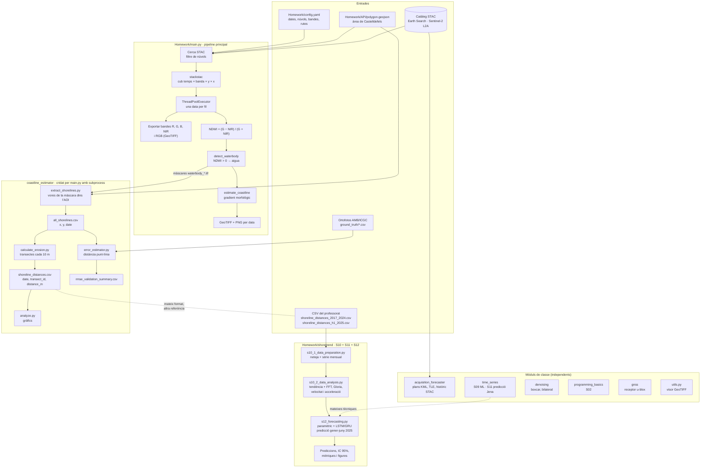
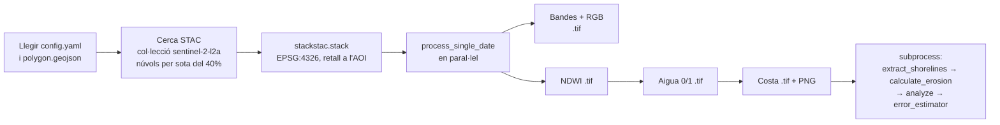
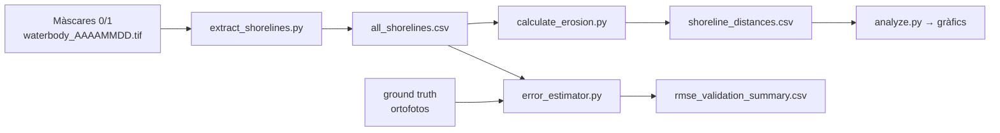
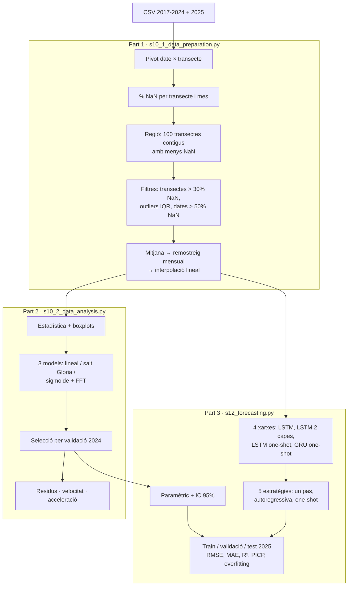

# CDIO1 — Software del Grau en Enginyeria de Sistemes Aeroespacials (Satèl·lits)

Repositori de l'assignatura **CDIO1** (EETAC, 2026). Conté el codi de classe que proporciona el professorat i la feina del grup: un sistema complet que, a partir d'imatges **Sentinel-2**, detecta la línia de costa de **Castelldefels**, en mesura l'erosió, la valida contra ortofotos i en **prediu l'evolució** amb models paramètrics i xarxes neuronals.

---

## Índex

1. [Instal·lació](#1-installació)
2. [Estructura del repositori](#2-estructura-del-repositori)
3. [Flowchart global](#3-flowchart-global)
4. [Pipeline principal: de Sentinel-2 a la línia de costa](#4-pipeline-principal-de-sentinel-2-a-la-línia-de-costa-homeworkmainpy)
5. [Coastline estimator: erosió i validació](#5-coastline-estimator-erosió-i-validació)
6. [ShoreTrend: anàlisi i predicció de l'erosió (S10–S12)](#6-shoretrend-anàlisi-i-predicció-de-lerosió-s10s12)
7. [Mòduls de classe](#7-mòduls-de-classe)
8. [Correspondència amb les sessions](#8-correspondència-amb-les-sessions)
9. [Problemes coneguts i avisos](#9-problemes-coneguts-i-avisos)

---

## 1. Instal·lació

La venv és a l'**arrel del repositori** (`Lib/`, `Scripts/`, `pyvenv.cfg`), amb Python 3.14.

```
python -m venv .                       # només la primera vegada
Scripts\python.exe -m pip install -r requirements.txt
```

> **Executa sempre els scripts des de l'arrel del repositori.** Molts fan servir rutes relatives (`coastline_estimator/...`, `acquisition_forecaster/projects/...`, `Homework/Big_Data/...`).

---

## 2. Estructura del repositori

```
CDIO1/
├── Homework/                     ★ FEINA DEL GRUP
│   ├── main.py                   Pipeline principal: Sentinel-2 → NDWI → aigua → costa → erosió → RMSE
│   ├── config.yaml               Configuració del pipeline (dates, núvols, bandes, rutes, scripts externs)
│   ├── polygon.geojson           Àrea d'interès (còpia)
│   ├── API/                      Versions de desenvolupament del pipeline i proves
│   │   ├── polygon.geojson       Àrea d'interès que fa servir main.py
│   │   ├── waterbodies/          Detecció d'aigua i línia de costa (funcions que importa main.py)
│   │   └── *.py                  Prototips: descàrrega STAC, multithreading, NDWI, visualització
│   ├── Big_Data/                 Preparació de dades de la S10 (en curs) + CSV del professorat
│   ├── shoretrend/               Anàlisi i predicció de l'erosió (S10, S11, S12)
│   ├── banda_*/, ndwi/, rgb/     Sortides de main.py (GeoTIFF, ignorades per git)
│   └── outputs/                  Sortides de main.py (màscares, costa, PNG)
│
├── coastline_estimator/          Scripts del professorat (adaptats pel grup): erosió i validació
│   ├── extract_shorelines.py     Màscares aigua/terra → punts de la línia de costa
│   ├── calculate_erosion.py      Línies de costa → distàncies per transecte
│   ├── analyze.py                Gràfics de les distàncies
│   ├── error_estimator.py        RMSE contra ortofotos (ground truth)
│   ├── shoreline_utils.py        Funcions comunes (dates, KMZ, ordenació de punts amb KDTree)
│   └── projects/castelldefels_h1_2025/   Entrades (polígon, ground truth) i sortides del projecte
│
├── acquisition_forecaster/       S19: quan passarà un satèl·lit per una zona
├── time_series/                  S09 i S11: ML, anàlisi i predicció de sèries (dades de Jena)
├── denoising/                    Filtres de soroll per a bandes Sentinel-2
├── programming_basics/           S02: fonaments (C vs Python, tipus, memòria, threads, tests...)
├── gnss/                         Lectura de dades en brut d'un receptor u-blox
├── utils.py                      Visualitzador ràpid de GeoTIFF
└── requirements.txt
```

---

## 3. Flowchart global



**Com llegir-lo.** Hi ha tres blocs de feina del grup, encadenats:

1. **`Homework/main.py`** descarrega Sentinel-2 i genera, per a cada data, la màscara d'aigua i la línia de costa.
2. En acabar, `main.py` crida els scripts de **`coastline_estimator`**, que converteixen aquestes màscares en distàncies per transecte i les validen amb ortofotos.
3. **`Homework/shoretrend`** analitza i prediu l'erosió a partir de la sèrie llarga 2017–2024 del professorat. Té el mateix format que la sortida del pas 2, però una línia de referència diferent.

Els mòduls de classe no depenen del pipeline. ShoreTrend reaprofita les tècniques de `time_series/s11_*`.

---

## 4. Pipeline principal: de Sentinel-2 a la línia de costa (`Homework/main.py`)

### Com executar-lo

```
Scripts\python.exe Homework\main.py
```

Es configura des de `Homework/config.yaml`:

| Clau | Valor actual | Significat |
|---|---|---|
| `geojson_file` | `polygon.geojson` | Polígon de l'àrea d'interès (a `Homework/API/`) |
| `search.start_date` / `end_date` | 2025-01-01 / 2025-06-30 | Finestra temporal |
| `search.max_cloud_cover` | 40 | % màxim de núvols de la imatge |
| `bands` | red, green, blue, nir | Bandes que es descarreguen |
| `performance.max_workers` | 100 | Fils en paral·lel (descàrrega limitada per xarxa) |
| `outputs.*` | `outputs/...` | Carpetes de sortida |
| `externalScripts.*` | `coastline_estimator`, `castelldefels_h1_2025` | Scripts i projecte que es criden al final |

### Què fa, pas a pas



1. **Configuració i AOI.** Llegeix el YAML i el polígon, i el reprojecta a EPSG:4326.
2. **Cerca STAC.** Consulta Earth Search per trobar imatges Sentinel-2 L2A de l'AOI que estiguin dins de les dates i per sota del límit de núvols.
3. **Cub de dades.** `stackstac` construeix un `xarray` (temps × banda × y × x) retallat a l'AOI. És *lazy*: res no es descarrega fins que es fa servir.
4. **Processament en paral·lel.** Un `ThreadPoolExecutor` processa una data per fil. Són fils i no processos perquè el coll d'ampolla és la descàrrega (E/S); per això `matplotlib` es configura amb el backend `Agg`, que és segur amb fils. Per a cada data:
   - exporta les bandes i la composició RGB com a GeoTIFF;
   - calcula el **NDWI** = (verd − NIR) / (verd + NIR). Si el denominador és ~0 hi posa 0. L'aigua reflecteix més el verd que l'infraroig proper, i per això surt positiva;
   - **`detect_waterbody`** (`API/waterbodies/coastline_functions.py`): NDWI > 0 → aigua (1), si no, terra (0);
   - **`estimate_coastline`**: el gradient morfològic (dilatació − erosió de la màscara) deixa només la vora entre aigua i terra;
   - desa les màscares en GeoTIFF, conservant la georeferència, i en PNG.
5. **Scripts externs.** Crida en ordre els quatre scripts de `coastline_estimator` (vegeu la secció 5) amb `subprocess`, passant-los el projecte `castelldefels_h1_2025` i la carpeta de màscares.

### Sortides

| Carpeta | Contingut |
|---|---|
| `Homework/banda_{red,green,blue,nir}/` | Bandes per data (`<banda>_AAAAMMDD.tif`) |
| `Homework/rgb/`, `Homework/ndwi/` | Composició RGB i NDWI per data |
| `Homework/outputs/outputs/waterbody/` | Màscares aigua/terra (vegeu la secció 9 sobre la ruta duplicada) |
| `Homework/outputs/outputs/coastline/` | Línia de costa en ràster |
| `Homework/outputs/outputs/plots/` | PNG de l'aigua i la costa |

### Altres fitxers de `Homework/API/`

Són les **versions anteriors** del pipeline, que es guarden com a referència. `main.py` en reuneix les funcionalitats.

| Fitxer | Què fa |
|---|---|
| `API call test.py` | Primera versió: cerca STAC, NDWI i RGB, i exportació a GeoTIFF (seqüencial i molt comentada) |
| `API_call_parallel.py` | Proves de `ThreadPoolExecutor` i `multiprocessing` |
| `API Multithreading + Cloud Cover.py` | Versió amb filtre de núvols, configuració YAML i multithreading |
| `visualise imatge tif.py` | Mostra `green.tif`, `nir.tif` i el NDWI resultant |
| `test_ndwi.py` | Tests `pytest` del càlcul del NDWI (cas normal, divisió per zero, NaN/inf) |
| `waterbodies/coastline_functions.py` | Funcions que importa `main.py` |
| `waterbodies/detect_water.py`, `coastline.py` | Versions anteriors separades de les mateixes funcions |
| `waterbodies/run_water_detection.py` | Executa la detecció per a una sola data (`20250115`) |
| `waterbodies/test_detect_water.py` | Test `pytest` de `detect_waterbody` |

Per executar els tests:

```
Scripts\python.exe -m pytest Homework\API\test_ndwi.py Homework\API\waterbodies\test_detect_water.py
```

---

## 5. Coastline estimator: erosió i validació

Scripts proporcionats pel professorat i adaptats pel grup. Treballen sobre un **projecte** dins de `coastline_estimator/projects/<projecte>/`:

```
coastline_estimator/projects/castelldefels_h1_2025/
├── input/
│   ├── config.json               Dates del projecte
│   ├── polygon.geojson           AOI
│   └── ground_truth/             Línies de costa d'ortofotos AMB/ICGC (2015-2022), CSV en UTM 31N
└── output/
    ├── estimated_waterbodies_edges/    Punts de costa per data (CSV, KMZ, GeoJSON) + all_shorelines.csv
    ├── estimated_erosion_accretion/    shoreline_distances.csv
    └── estimated_error/                rmse_validation_summary.csv
```

### Execució manual (main.py ho fa sol)

```
Scripts\python.exe coastline_estimator\extract_shorelines.py -p castelldefels_h1_2025 --mask-dir Homework\outputs\outputs\waterbody --polygon Homework\API\polygon.geojson
Scripts\python.exe coastline_estimator\calculate_erosion.py -p castelldefels_h1_2025 --no-plot
Scripts\python.exe coastline_estimator\analyze.py -p castelldefels_h1_2025
Scripts\python.exe coastline_estimator\error_estimator.py -p castelldefels_h1_2025 -g coastline_estimator\projects\castelldefels_h1_2025\input\ground_truth --no-plot
```

`error_estimator.py` també accepta `-d AAAA-MM-DD` per validar només una data concreta del ground truth.

### Què fa cada script



| Script | Lògica |
|---|---|
| **`extract_shorelines.py`** | Per a cada màscara, convoluciona amb un nucli 3×3 i es queda amb els píxels d'aigua que tenen algun veí de terra, és a dir, els de la vora. Només ho fa dins de l'AOI, erosionat perquè no surti la vora del polígon. Desa els punts per data (CSV lat/lon i x/y, KMZ, GeoJSON) i els uneix tots a `all_shorelines.csv`. Si una data ja està processada, se la salta. |
| **`calculate_erosion.py`** | Reprojecta les línies de costa a UTM (metres). Agafa la **primera data com a línia de referència**, la suavitza amb una spline i hi posa **transectes perpendiculars cada 10 m** (100 m de llargada). Per a cada data i transecte calcula la distància amb signe fins a la intersecció amb la línia de costa. Resultat: `shoreline_distances.csv` (`date, transect_id, reference_x, reference_y, distance_m`). |
| **`analyze.py`** | Dos gràfics: el perfil de distàncies per transecte de cada data, i l'evolució de la distància mitjana en el temps. |
| **`error_estimator.py`** | Per a cada fitxer de ground truth, busca la data Sentinel-2 més propera, i la descarta si està a més de 60 dies. Passa totes dues línies a UTM 31N, retalla el ground truth al mateix rang X i calcula el **RMSE** de les distàncies punt-línia en metres. |
| **`shoreline_utils.py`** | Funcions comunes: treure la data del nom del fitxer, exportar a KMZ, llegir CSV de coordenades, ruta del projecte i **`build_ordered_linestring`**. Aquesta última ordena els punts de costa per veí més proper amb un **KDTree**, per construir una línia sense esgotar la memòria. |
| `calculate_erosionOG.py`, `tests.py` | Còpies **idèntiques** de la versió original de `calculate_erosion.py`, que es guarden com a referència. |

---

## 6. ShoreTrend: anàlisi i predicció de l'erosió (S10–S12)

Treballa amb la **sèrie llarga 2017–2024** del professorat (Atenea) per caracteritzar l'erosió de Castelldefels i predir gener–juny 2025.

### Com executar-lo

1. Copia els CSV del professorat a `Homework/shoretrend/data/`:
   - `shoreline_distances_2017_2024.csv` (obligatori)
   - `shoreline_distances_2025.csv`: és el `shoreline_distances_h1_2025.csv` d'Atenea, reanomenat. Serveix per validar la predicció.
2. Executa les tres parts **en ordre**, des de l'arrel. Cada part llegeix el que ha desat l'anterior:

```
Scripts\python.exe Homework\shoretrend\s10_1_data_preparation.py
Scripts\python.exe Homework\shoretrend\s10_2_data_analysis.py
Scripts\python.exe Homework\shoretrend\s12_forecasting.py
```

Temps (CPU): ~10 s, ~5 s, i ~8 min la primera vegada (entrena 4 xarxes) o ~30 s després (carrega les guardades). Totes les figures i taules es desen a `Homework/shoretrend/output/part{1,2,3}/`.

| Opció | Efecte |
|---|---|
| `s10_1 -i <csv> -o <csv>` | Altres CSV d'entrada |
| `s10_1 --start-transect N` | Fixa la regió de 100 transectes a partir de `N` |
| `s10_1 --freq W\|2W\|MS` | Freqüència de remostreig (per defecte, mensual) |
| `s10_2 --model linear\|step\|sigmoid` | Força el model paramètric |
| `s10_2 --n-freq N` | Nombre de cicles FFT (per defecte 2) |
| `s12 --retrain` | Torna a entrenar les xarxes. **Cal fer-ho si canvien les dades o les Parts 1–2.** |

### Flux



### Lògica

**Part 1, preparació.**
- La regió es tria amb una finestra mòbil: és el bloc de **transectes contigus** (una zona física de platja) amb menys dades que falten.
- Els outliers es calculen **per transecte**, perquè cada tram de platja té la seva pròpia posició mitjana.
- Es comparen el remostreig setmanal, bisetmanal i mensual. El mensual no deixa intervals buits i és el que fan servir les diapositives.
- Les observacions de 2025 passen pels mateixos transectes i límits que l'històric, i **no s'interpolen**.

**Part 2, anàlisi.** El model és `y(t) = tendència(t) + Σ cicles FFT`. La tendència pot ser:
- lineal;
- lineal + **salt de Heaviside** al febrer de 2020 (temporal **Gloria**);
- lineal + **sigmoide**, amb `k` i `t₀` ajustats amb `curve_fit`.

Els cicles són les 2 freqüències més fortes de la FFT del residu. El model **no es tria per R²**, que sempre afavoreix el més complex, sinó per la **predicció de 2024 fent servir només les dades fins al 2023**. La velocitat (`np.gradient`, m/any) i l'acceleració (m/any²) es calculen sobre el model i sobre la mitjana mòbil de 12 mesos, que elimina el cicle anual.

**Part 3, predicció.**
- **Paramètric:** el model escollit es reajusta amb tot el 2017–2024 i s'estén 6 mesos, amb un IC del 95% `ŷ ± 1,96·σ·√(1+h/n)`.
- **Xarxes:**
  - `MinMaxScaler` ajustat només amb l'entrenament;
  - finestres de 12 mesos i validació cronològica del 20% final;
  - `EarlyStopping` amb la millor època;
  - Keras amb backend PyTorch.
- **Estratègies (S11):**
  - **un pas**: fa servir les observacions de 2025 com a entrada, i per tant **no és una predicció real**;
  - **autoregressiva**: cada predicció entra a la finestra del pas següent;
  - **one-shot**: els 6 mesos d'una sola passada.
- **Avaluació:** mètriques de train, validació i test, PICP i el criteri d'overfitting de la S11 (`R²_train − R²_test > 0,1`).

---

## 7. Mòduls de classe

### `time_series/`: aprenentatge automàtic i sèries temporals (S09, S11)

Dades: temperatura diària de Jena 2009–2017 (`time_series/data/`, CC BY 4.0, Max Planck Institute). Els scripts fan servir rutes relatives i s'han d'executar **des de `time_series/`**:

```
cd time_series
..\Scripts\python.exe s11_1_ts_prediction_lr_fft_jena.py
```

| Script | Què fa |
|---|---|
| `s09_1_classifiers.py` | Classificació del dataset Iris: KNN, arbre, Naive Bayes, SVM, MLP |
| `s09_2_regression.py` | Regressió de preus d'habitatges de Califòrnia: lineal, arbre, random forest, gradient boosting, MLP |
| `s09_3_ts_analysis_jena.py` | Pipeline complet d'anàlisi: NaN, outliers, remostreig, estadística, tendència, FFT, descomposició, residus |
| `s11_1_ts_prediction_lr_fft_jena.py` | Predicció amb tendència + FFT, IC del 95% i PICP |
| `s11_2_ts_prediction_lstm_jena_one_step.py` | LSTM d'un pas (finestra de 90 dies) |
| `s11_3_ts_prediction_lstm_jena_autoregressive.py` | El mateix model, aplicat de forma autoregressiva durant 365 dies |
| `s11_4_ts_prediction_lstm_jena_one_shot.py` | LSTM one-shot (365 → 365 dies) amb Dropout |
| `s11_5_ts_prediction_gru_jena_one_shot.py` | GRU one-shot |

Els models es desen a `time_series/models/` i les figures a `time_series/output/`. Els models de `s11_2` i `s11_3` comparteixen nom: `s11_3` reutilitza el que entrena `s11_2`. Cal `KERAS_BACKEND=torch` (vegeu la secció 1).

### `acquisition_forecaster/`: previsió d'adquisicions (S19)

Respon la pregunta: quan capturarà un satèl·lit una zona? Cada projecte té `projects/<projecte>/input/config.json` amb el punt i les dates.

| Script | Entrada | Què fa |
|---|---|---|
| `plan_parser.py` | Plans d'adquisició KML de Sentinel-2 (`input/sentinel_plans/`) | Filtra les adquisicions previstes que contenen el punt |
| `pass_forecaster.py` | TLE del satèl·lit (`input/tle`) | Propaga l'òrbita amb `skyfield` i calcula quan passa per sobre del punt |
| `historical_analysis.py` | Catàleg STAC | `--action acquire`: desa les captures passades (`.pkl`); `--action plot`: les representa |

```
Scripts\python.exe -m acquisition_forecaster.plan_parser --project eetac_27_11_25
Scripts\python.exe -m acquisition_forecaster.pass_forecaster --project troll_27_11_25
Scripts\python.exe -m acquisition_forecaster.historical_analysis --project eetac_2025 --action acquire
Scripts\python.exe -m acquisition_forecaster.historical_analysis --project eetac_2025 --action plot
```

### `denoising/`: reducció de soroll

Retalla les bandes verd i NIR a l'AOI, les normalitza (percentils 2–98) i les filtra amb un filtre de caixa 4×4 o bilateral. Mostra l'abans i el després.

```
Scripts\python.exe denoising\main.py -g <green.tif> -n <nir.tif> -a <aoi.geojson> -d bilateral
```

### `programming_basics/`: fonaments (S02)

| Carpeta | Tema |
|---|---|
| `hello/` | Hola món en C i Python |
| `datatypes/` | Tipatge estàtic (C) vs dinàmic (Python); demos de numpy, matplotlib, pandas, xarray i pickle (`--numpy`, `--pandas`, ...) |
| `memory/` | Memòria dinàmica: `malloc`/`free` en C vs llistes en Python |
| `threading_multiprocessing/` | Benchmark de fils vs processos per a tasques d'E/S i de CPU |
| `checkpointing_and_caching/` | Desar l'estat intermedi amb `pickle` per reprendre després d'una fallada (`--failure-point`) |
| `unit_testing/` | Tests amb `pytest` |
| `stac_catalogs/` | Consultes a catàlegs STAC |
| `matrix_visualizer/` | Visualitzar una matriu amb `matplotlib` (backend Qt) |
| `streamlit_demo/` | Primera app web amb Streamlit |

El codi en C es compila i s'executa així:

```
gcc <fitxer.c> -o <sortida>      # Linux (a macOS: clang)
./<sortida>
```

Python:

```
python <fitxer.py>
streamlit run programming_basics/streamlit_demo/main.py
pytest programming_basics/unit_testing/test.py
```

Per mesurar el temps d'execució (Linux/macOS): `time ./<sortida>` o `time python <fitxer.py>`. `real` és el temps total, `user` el temps en mode usuari i `sys` el temps en mode nucli.

### `gnss/`: receptor GNSS u-blox

`configure_receiver.py` activa els missatges de mesures en brut (UBX-RXM-RAWX) per port sèrie, i `logger.py` desa el flux a `output/raw_output.ubx`. El port està fixat a `/dev/ttyACM0` (Linux); a Windows cal canviar-lo per `COMx`.

### `utils.py`

Visor ràpid d'un GeoTIFF (una banda, en escala de grisos):

```
Scripts\python.exe utils.py <imatge.tif>
```

---

## 8. Correspondència amb les sessions

| Sessió | Tema | On és |
|---|---|---|
| S02 | Fonaments de programació | `programming_basics/` |
| S09 | Classificació, regressió, anàlisi de sèries | `time_series/s09_*` |
| Projecte | Descàrrega Sentinel-2, NDWI, aigua, costa | `Homework/main.py`, `Homework/API/` |
| Projecte | Erosió i validació amb ortofotos | `coastline_estimator/` |
| S10 | Preparació i anàlisi de l'erosió de Castelldefels | `Homework/shoretrend/s10_*`, `Homework/Big_Data/` |
| S11 | Predicció: tendència + FFT, IC, LSTM/GRU | `time_series/s11_*` (Jena) i `Homework/shoretrend/s12_forecasting.py` (costa) |
| S12 | Predicció gener–juny 2025 i comparació de models | `Homework/shoretrend/s12_forecasting.py` |
| S19 | Previsió d'adquisicions | `acquisition_forecaster/` |

---

## 9. Problemes coneguts i avisos

| Problema | On | Efecte | Solució |
|---|---|---|---|
| Es compara `subprocess.run(...) == 0` en lloc de `.returncode == 0` | `Homework/main.py` (4 crides) | Sempre escriu "Error en executar…", encara que el script hagi funcionat | Fer servir `resultat.returncode == 0` |
| Ruta duplicada: `os.path.join(project_root, "outputs", "outputs/waterbody")` | `Homework/main.py` + `config.yaml` | Les màscares van a `Homework/outputs/outputs/waterbody/` | Treure `"outputs"` del codi o el prefix `outputs/` del YAML |
| `-d none` no està implementat | `denoising/main.py` | L'opció apareix a `choices`, però no té branca: falla amb `NameError` | Afegir `else:` que copiï les imatges sense filtrar |
| `analyze.py` fa `plt.show()` | Cridat des de `main.py` | Pot obrir finestres i deixar `main.py` esperant fins que es tanquin | Afegir-hi una opció `--no-plot` |
| Rutes relatives | `main.py`, `coastline_estimator`, `acquisition_forecaster`, `Big_Data` | Fallen si no s'executen des de l'arrel | Executar sempre des de l'arrel (o des de `time_series/` per als seus scripts) |
| Llibreries fora de `requirements.txt` | Vegeu la secció 1 | Una venv nova no les té | Instal·lar-les a mà o afegir-les |
| Signe de `distance_m` | CSV del professorat i `calculate_erosion.py` | Gloria surt com a salt **positiu** (+13,6 m), però el màxim estacional cau a l'estiu: hi ha dues lectures possibles | Confirmar el conveni abans d'interpretar erosió vs acreció |
| Referències diferents | `shoreline_distances.csv` del projecte vs CSV del professorat | El nostre CSV mesura respecte a la primera data de 2025; no és comparable amb la sèrie 2017–2024 | Fer servir els CSV del professorat per a ShoreTrend |
| CSV duplicat | `Homework/Big_Data/` i `Homework/shoretrend/data/` | Dues còpies de 22 MB al repositori | Deixar-ne una |
| `.gitignore` | Arrel | Ignora la venv, `*.tif`, `*.png` (excepte les figures de ShoreTrend) i les sortides de `time_series/` | — |
